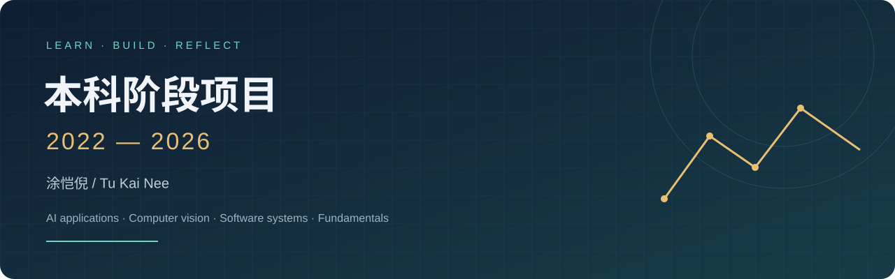

# 本科阶段项目（2022-2026）

**涂恺倪 · Tu Kai Nee**  
从编程基础、计算机组成到计算机视觉和 AI 应用的课程与项目档案。

**12 个分类 · 15 个项目 · 按实际内容归档 · 可核对的验证记录**

[项目导航](#项目导航) · [验证记录](docs/VALIDATION.md) · [整理记录](docs/CHANGELOG.md) · [来源与贡献](THIRD_PARTY_NOTICES.md)

## 建议从这里开始

| 项目 | 可以查看的内容 | 当前状态 |
| --- | --- | --- |
| [iCure本机医疗管理系统](%E8%AE%A1%E7%AE%97%E6%9C%BA%E4%B8%93%E4%B8%9A%E5%9F%BA%E7%A1%80%E5%AE%9E%E4%B9%A0/%E9%A1%B9%E7%9B%AE1-iCure%E6%9C%AC%E6%9C%BA%E5%8C%BB%E7%96%97%E7%AE%A1%E7%90%86%E7%B3%BB%E7%BB%9F/README.md) | 基于原团队项目整理的 Python 本机版本，覆盖医患角色、预约、沟通与离线问诊整理。 | 11 组 HTTP/权限/数据回归通过；JavaScript 语法检查通过 |
| [TextCNN情感分类](Python%E8%AF%AD%E8%A8%80%E7%A8%8B%E5%BA%8F%E8%AE%BE%E8%AE%A1/%E9%A1%B9%E7%9B%AE1-TextCNN%E6%83%85%E6%84%9F%E5%88%86%E7%B1%BB/README.md) | 用卷积神经网络对英文电影短评进行二分类，并保留两种框架的学习轨迹。 | 数据划分回归通过；合成样本训练、保存和重新加载通过；完整语料训练未复现 |
| [YOLO作物与杂草检测](%E8%AE%A1%E7%AE%97%E6%9C%BA%E8%A7%86%E8%A7%89/%E9%A1%B9%E7%9B%AE1-YOLO%E4%BD%9C%E7%89%A9%E4%B8%8E%E6%9D%82%E8%8D%89%E6%A3%80%E6%B5%8B/README.md) | 整理目标检测训练、图片预测与 CSV 结果导出流程。 | 空检测、CSV 坐标和类别统计回归通过；未重训/评估 YOLO |
| [CPU与CUDA的KMeans聚类](%E5%B9%B6%E8%A1%8C%E7%BC%96%E7%A8%8B%E5%8E%9F%E7%90%86%E4%B8%8E%E5%AE%9E%E8%B7%B5/%E9%A1%B9%E7%9B%AE1-CPU%E4%B8%8ECUDA%E7%9A%84KMeans%E8%81%9A%E7%B1%BB/README.md) | 对照串行聚类与 CUDA 并行实现，整理构建入口及数据格式。 | CPU 编译及 7 项检查通过；CUDA 未编译 |

## 项目导航

| 分类 | 项目 | 主要技术 |
| --- | --- | --- |
| [Java语言程序设计](Java%E8%AF%AD%E8%A8%80%E7%A8%8B%E5%BA%8F%E8%AE%BE%E8%AE%A1/README.md) | [Java基础算法练习](Java%E8%AF%AD%E8%A8%80%E7%A8%8B%E5%BA%8F%E8%AE%BE%E8%AE%A1/%E9%A1%B9%E7%9B%AE1-Java%E5%9F%BA%E7%A1%80%E7%AE%97%E6%B3%95%E7%BB%83%E4%B9%A0/README.md) | Java / 标准库 |
| [Python语言程序设计](Python%E8%AF%AD%E8%A8%80%E7%A8%8B%E5%BA%8F%E8%AE%BE%E8%AE%A1/README.md) | [TextCNN情感分类](Python%E8%AF%AD%E8%A8%80%E7%A8%8B%E5%BA%8F%E8%AE%BE%E8%AE%A1/%E9%A1%B9%E7%9B%AE1-TextCNN%E6%83%85%E6%84%9F%E5%88%86%E7%B1%BB/README.md) / [键盘贪吃蛇](Python%E8%AF%AD%E8%A8%80%E7%A8%8B%E5%BA%8F%E8%AE%BE%E8%AE%A1/%E9%A1%B9%E7%9B%AE2-%E9%94%AE%E7%9B%98%E8%B4%AA%E5%90%83%E8%9B%87/README.md) | Python / PyTorch / MindSpore / Python / Pygame |
| [并行编程原理与实践](%E5%B9%B6%E8%A1%8C%E7%BC%96%E7%A8%8B%E5%8E%9F%E7%90%86%E4%B8%8E%E5%AE%9E%E8%B7%B5/README.md) | [CPU与CUDA的KMeans聚类](%E5%B9%B6%E8%A1%8C%E7%BC%96%E7%A8%8B%E5%8E%9F%E7%90%86%E4%B8%8E%E5%AE%9E%E8%B7%B5/%E9%A1%B9%E7%9B%AE1-CPU%E4%B8%8ECUDA%E7%9A%84KMeans%E8%81%9A%E7%B1%BB/README.md) | C++ / CUDA / CMake |
| [操作系统与计算机组成](%E6%93%8D%E4%BD%9C%E7%B3%BB%E7%BB%9F%E4%B8%8E%E8%AE%A1%E7%AE%97%E6%9C%BA%E7%BB%84%E6%88%90/README.md) | [RISCV单周期处理器](%E6%93%8D%E4%BD%9C%E7%B3%BB%E7%BB%9F%E4%B8%8E%E8%AE%A1%E7%AE%97%E6%9C%BA%E7%BB%84%E6%88%90/%E9%A1%B9%E7%9B%AE1-RISCV%E5%8D%95%E5%91%A8%E6%9C%9F%E5%A4%84%E7%90%86%E5%99%A8/README.md) | Verilog / RISC-V / Vivado |
| [机器学习](%E6%9C%BA%E5%99%A8%E5%AD%A6%E4%B9%A0/README.md) | [手势控制贪吃蛇](%E6%9C%BA%E5%99%A8%E5%AD%A6%E4%B9%A0/%E9%A1%B9%E7%9B%AE1-%E6%89%8B%E5%8A%BF%E6%8E%A7%E5%88%B6%E8%B4%AA%E5%90%83%E8%9B%87/README.md) | Python / OpenCV / MediaPipe |
| [计算机视觉](%E8%AE%A1%E7%AE%97%E6%9C%BA%E8%A7%86%E8%A7%89/README.md) | [YOLO作物与杂草检测](%E8%AE%A1%E7%AE%97%E6%9C%BA%E8%A7%86%E8%A7%89/%E9%A1%B9%E7%9B%AE1-YOLO%E4%BD%9C%E7%89%A9%E4%B8%8E%E6%9D%82%E8%8D%89%E6%A3%80%E6%B5%8B/README.md) | Python / Ultralytics / YOLO |
| [计算机专业基础实习](%E8%AE%A1%E7%AE%97%E6%9C%BA%E4%B8%93%E4%B8%9A%E5%9F%BA%E7%A1%80%E5%AE%9E%E4%B9%A0/README.md) | [iCure本机医疗管理系统](%E8%AE%A1%E7%AE%97%E6%9C%BA%E4%B8%93%E4%B8%9A%E5%9F%BA%E7%A1%80%E5%AE%9E%E4%B9%A0/%E9%A1%B9%E7%9B%AE1-iCure%E6%9C%AC%E6%9C%BA%E5%8C%BB%E7%96%97%E7%AE%A1%E7%90%86%E7%B3%BB%E7%BB%9F/README.md) / [iCure原版Qt团队项目](%E8%AE%A1%E7%AE%97%E6%9C%BA%E4%B8%93%E4%B8%9A%E5%9F%BA%E7%A1%80%E5%AE%9E%E4%B9%A0/%E9%A1%B9%E7%9B%AE2-iCure%E5%8E%9F%E7%89%88Qt%E5%9B%A2%E9%98%9F%E9%A1%B9%E7%9B%AE/README.md) | Python 标准库 / SQLite / HTML / CSS / JavaScript / C++ / Qt Widgets / Qt Network / Qt SQL |
| [认知神经科学](%E8%AE%A4%E7%9F%A5%E7%A5%9E%E7%BB%8F%E7%A7%91%E5%AD%A6/README.md) | [手部关键点与摄像头交互](%E8%AE%A4%E7%9F%A5%E7%A5%9E%E7%BB%8F%E7%A7%91%E5%AD%A6/%E9%A1%B9%E7%9B%AE1-%E6%89%8B%E9%83%A8%E5%85%B3%E9%94%AE%E7%82%B9%E4%B8%8E%E6%91%84%E5%83%8F%E5%A4%B4%E4%BA%A4%E4%BA%92/README.md) | Python / OpenCV / MediaPipe |
| [智能图形学](%E6%99%BA%E8%83%BD%E5%9B%BE%E5%BD%A2%E5%AD%A6/README.md) | [可微网格渲染](%E6%99%BA%E8%83%BD%E5%9B%BE%E5%BD%A2%E5%AD%A6/%E9%A1%B9%E7%9B%AE1-%E5%8F%AF%E5%BE%AE%E7%BD%91%E6%A0%BC%E6%B8%B2%E6%9F%93/README.md) / [JNeRF复现实验资料](%E6%99%BA%E8%83%BD%E5%9B%BE%E5%BD%A2%E5%AD%A6/%E9%A1%B9%E7%9B%AE2-JNeRF%E5%A4%8D%E7%8E%B0%E5%AE%9E%E9%AA%8C%E8%B5%84%E6%96%99/README.md) | Python / Jittor / JRender / Python / JNeRF / Jittor / CUDA |
| [自然语言处理](%E8%87%AA%E7%84%B6%E8%AF%AD%E8%A8%80%E5%A4%84%E7%90%86/README.md) | [MiniChat本地推理](%E8%87%AA%E7%84%B6%E8%AF%AD%E8%A8%80%E5%A4%84%E7%90%86/%E9%A1%B9%E7%9B%AE1-MiniChat%E6%9C%AC%E5%9C%B0%E6%8E%A8%E7%90%86/README.md) | Python / Transformers / PyTorch |
| [毕业设计](%E6%AF%95%E4%B8%9A%E8%AE%BE%E8%AE%A1/README.md) | [基于深度学习的空间基因表达预测](%E6%AF%95%E4%B8%9A%E8%AE%BE%E8%AE%A1/%E9%A1%B9%E7%9B%AE1-%E5%9F%BA%E4%BA%8E%E6%B7%B1%E5%BA%A6%E5%AD%A6%E4%B9%A0%E7%9A%84%E7%A9%BA%E9%97%B4%E5%9F%BA%E5%9B%A0%E8%A1%A8%E8%BE%BE%E9%A2%84%E6%B5%8B/README.md) | Python / FastAPI / PyTorch / 空间转录组 |
| [数据库原理与实践](%E6%95%B0%E6%8D%AE%E5%BA%93%E5%8E%9F%E7%90%86%E4%B8%8E%E5%AE%9E%E8%B7%B5/README.md) | [订单管理SQL综合实验](%E6%95%B0%E6%8D%AE%E5%BA%93%E5%8E%9F%E7%90%86%E4%B8%8E%E5%AE%9E%E8%B7%B5/%E9%A1%B9%E7%9B%AE1-%E8%AE%A2%E5%8D%95%E7%AE%A1%E7%90%86SQL%E7%BB%BC%E5%90%88%E5%AE%9E%E9%AA%8C/README.md) | SQL / MySQL 8 |

## 快速体验

希望直接查看完整业务流程，可从 iCure 本机版开始：Python 标准库服务配合浏览器界面，不需要 Qt 或数据库安装。希望查看训练代码，可阅读 TextCNN 的数据划分、训练与检查点加载。CUDA、Qt、JNeRF、RISC-V 与毕业设计的特殊依赖，分别写在项目 README 中。

每个项目独立运行，不要求一次性安装全部课程依赖。仓库根目录提供：

```text
python tools/check_portfolio.py
python -m unittest discover -s tests -v
python tools/check_native.py
```

第一条检查源码、文档链接和不应进入版本库的文件；第二条检查独立算法与研究接口；第三条需要 JDK 和 g++，验证 Java 与 KMeans CPU。完整依赖与结果见[验证记录](docs/VALIDATION.md)。

## 关于这份档案

本科项目覆盖 2022–2026 年，当前目录和发布版于 **2026-10-30** 整理。修复、补全和重构记录单独列出，不作为当年已经完成的内容。模型训练、设备交互和历史环境未复现的部分均写明状态，不将教学示例或上游框架算作个人原创成果。

原始资料保留在本地；此仓库只包含经筛选的源码、必要资源和说明。空目录、虚拟环境、整份数据集、训练权重、私人数据库、查重/签字材料和软件安装包未上传。按内容修正了两处原始分类，见[来源映射](docs/SOURCE_MAP.md)。

团队与开源来源见[来源声明](THIRD_PARTY_NOTICES.md)。求职阅读顺序与个人职责与证据见[项目阅读指南](docs/PORTFOLIO_GUIDE.md)。
