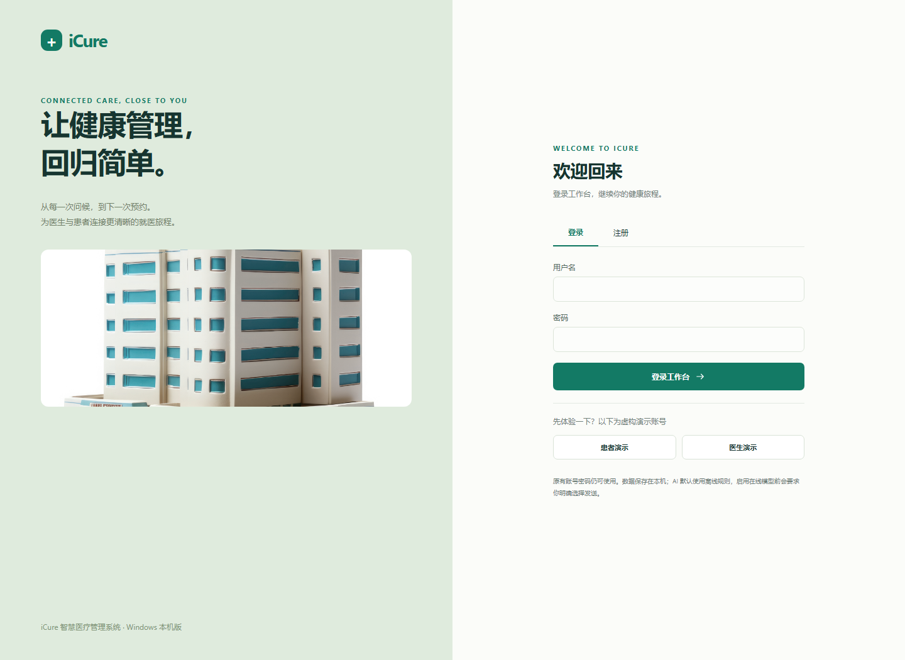

# iCure本机医疗管理系统

基于原团队项目整理的 Python 本机版本，覆盖医患角色、预约、沟通与离线问诊整理。

> 技术栈：Python 标准库 / SQLite / HTML / CSS / JavaScript  
> 验证范围：11 组 HTTP/权限/数据回归通过；JavaScript 语法检查通过

## 项目内容

零第三方 Python 依赖；公开版首次启动只创建虚构演示账号，不包含原患者、医生、附件、数据库或账号。离线助手不生成诊断，预约由用户确认。团队项目身份与近期迁移工作分开说明。原版分工据项目 PPT 第 8 页核实。

## 运行方式

在本项目目录打开终端，先确认项目所需的运行环境。Python 项目建议使用独立虚拟环境；下方 `path/to/...` 是需要替换的本地路径。

```text
python server.py --no-browser
# 浏览器打开 http://127.0.0.1:8765
python -m unittest discover -s tests -v
```

## 文件导航

- `agent.py`
- `database.py`
- `dist/`：直接使用的静态前端（此项目的运行资源）
- `docs/`
- `server.py`
- `Start.cmd`
- `tests/`：项目回归测试
- `一键启动.cmd`

## 来源与整理边界

iCure-Windows；原 Qt 团队为 Ku Yee Siang、Xu Jian Fa、Guo Gui Ying、Too Kai Ni（涂恺倪）、Bee Jun Rong。

本仓库于 2026-10-30 整理。补全与重构属于此次维护，不反推为 2022–2026 年期间已完成的工作；原始版本统一收在 `legacy/`（如有）。完整验证范围见[验证记录](../../docs/VALIDATION.md)，署名与上游说明见[来源声明](../../THIRD_PARTY_NOTICES.md)。

[返回课程目录](../README.md) · [返回项目集首页](../../README.md)

## 演示与运行



| 身份 | 演示用户名 | 演示密码 |
| --- | --- | --- |
| 患者 | demo_patient | icure2026 |
| 医生 | demo_doctor | icure2026 |

这些是程序专门生成的公开演示账号。只监听本机 `127.0.0.1`，端口占用时以终端输出为准。退出可在启动终端按 Ctrl+C。首次运行会创建本地 `data/`，该目录被 Git 忽略。可以双击 `Start.cmd`，或运行 `python server.py --no-browser`。

默认离线规则助手不需要联网。可选在线模型的密钥仅在运行时输入，仓库中不附带；在线调用需要用户在界面中明确选择。预约仅是教学系统内的记录，不连接真实医院平台。

原版是团队成果。项目 PPT 第 8 页列明涂恺倪担任 TL（团队领袖），分工为医生端系统、聊天机器人和系统翻译功能。原 Qt 源码可对应医生端与 QTranslator 切换入口，聊天机器人完整原版实现尚未在当前源码包中确认。近期 Python 迁移与本次去除私人数据的整理单独记录，不能归为原本科提交版本。

## 个人职责

涂恺倪：TL（团队领袖）；PPT 记录的分工为医生端系统、聊天机器人、系统翻译功能。已将原版实际可核对的代码与后续重构分开说明，详见[个人职责与实现证据](../../docs/ICURE_CONTRIBUTIONS.md)。
